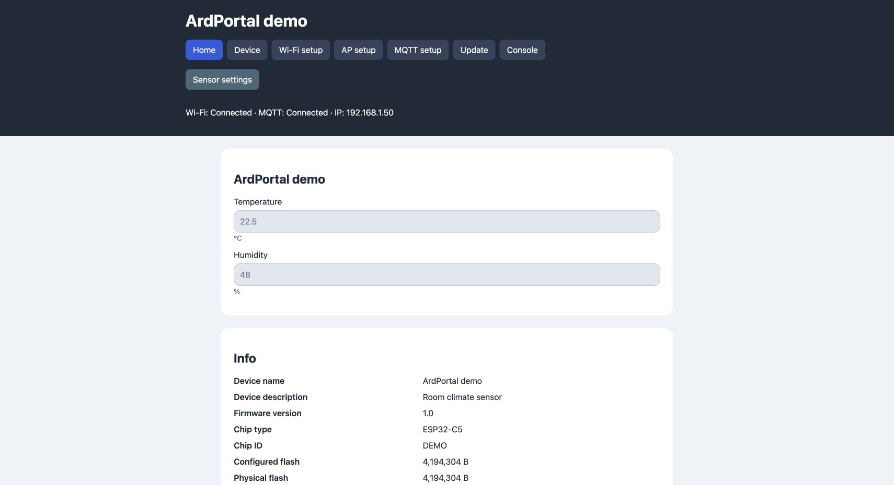
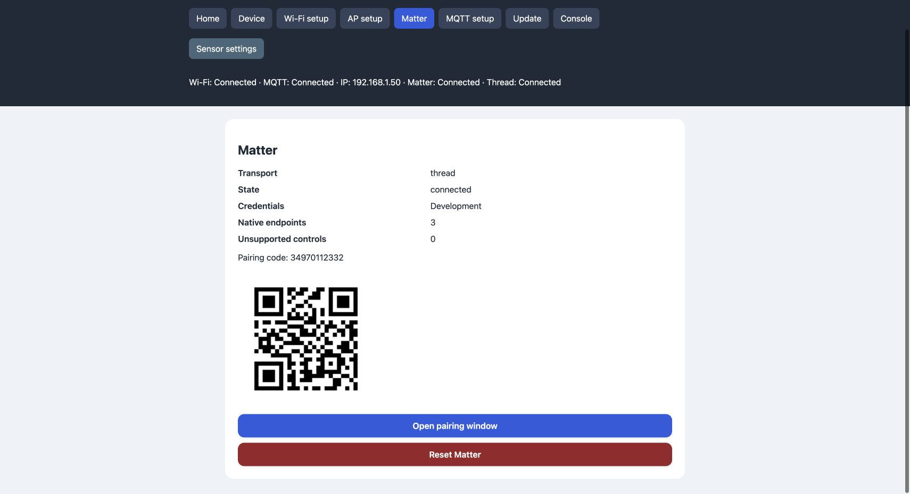

<!-- Author: Radoslaw Kubera (rkubera on GitHub). License: MIT. -->

# ArdPortal

ArdPortal is a modular Arduino library for ESP8266 and ESP32: a device configuration portal, MQTT/Home Assistant integration and optional native Zigbee or Matter integration. The standard Arduino build uses the ESP Arduino core; Matter also has a pinned ESP-IDF/ESP-Matter source-build project. No external web server or MQTT library is required.

- Wi-Fi configuration, fallback access point and captive portal.
- MQTT with optional verified TLS and automatic Home Assistant discovery.
- JSON-defined pages with 30 control types, optional shared semantic classes, visibility conditions and live updates.
- Persistent settings through **ArdFS**, the included flash filesystem and journaled storage API.
- JSON parsing and serialization through the standalone **ArdJSON** module.
- OTA firmware upload, diagnostics console, device information and restart controls.
- Native Zigbee End Device or Router on ESP32-C5/C6/H2, automatic control mapping, Zigbee2MQTT converter and ZHA quirk export, Zigbee OTA and diagnostics.
- Matter over Wi-Fi or Thread, BLE commissioning, local QR codes, development/production credentials and shared control mappings.
- Runtime Wi-Fi/portal suspension while Zigbee or Matter over Thread keeps running.
- Compile-time defines to include only the required features.

**[Full documentation and API reference → GitHub Wiki](https://github.com/rkubera/ArdPortal/wiki)**

## Portal preview

Current portal frontend with illustrative temperature and humidity readings:



[See more portal screenshots](https://github.com/rkubera/ArdPortal/wiki/Screenshots) · [Explore all 30 controls](https://github.com/rkubera/ArdPortal/wiki/Controls)

## Install and connect

Install **ArdPortal** through Arduino Library Manager, or download a [release ZIP](https://github.com/rkubera/ArdPortal/releases) and use **Sketch → Include Library → Add .ZIP Library**. Install the ESP8266 or ESP32 Arduino board package and select a board/flash layout with room for ArdFS and, if needed, OTA.

For the first connection, upload **File → Examples → ArdPortal → BasicPortal** ([sketch](examples/BasicPortal/BasicPortal.ino)). On a device without saved Wi-Fi credentials, connect to **`ArdUI-<chip ID>`**, using password **`1234567890`**, then open **http://192.168.4.1/** to configure it.

## Minimal sketch

```cpp
#include <ArdPortal.h>

ArdPortal portal;

void setup() {
  portal.begin();
}

void loop() {
  portal.loop();
  // Run nonblocking application work here.
}
```

Call `loop()` frequently: initialization, networking and storage advance cooperatively. Configuration loading completes asynchronously; see the [Portal API](https://github.com/rkubera/ArdPortal/wiki/Portal-API) before reading saved settings. Sensor examples may require their sensor libraries.

## Zigbee extension

Use the same JSON controls and AppConfig API over Zigbee, with or without Wi-Fi, WWW, MQTT or MQTT Home Assistant Discovery. Select **End Device** or **Router** at compile time; network joining/rejoining, state synchronization and persistent settings are handled by ArdPortal. The sketch provides sensor readings and actuator behavior.

Start with [ZigbeeClimate](examples/ZigbeeClimate/ZigbeeClimate.ino) for a slider and thermostat, or [ZigbeePortal](examples/ZigbeePortal/ZigbeePortal.ino) for a broader control example. Select the matching Zigbee ED/ZCZR board mode and keep the example's `partitions.csv`.

```cpp
// Before #include <ArdPortal.h>:
#define ARDPORTAL_ENABLE_ZIGBEE 1
#define ARDPORTAL_ZIGBEE_ROUTER 0 // End Device; 1 selects Router
#define ARDPORTAL_ENABLE_MQTT 0   // Optional: Zigbee does not need MQTT on the ESP
#define ARDPORTAL_ENABLE_HA 0
```

The Zigbee page provides network management and download buttons for a **layout-specific Zigbee2MQTT converter** and **ZHA quirk**. One exported file matches multiple devices with the same control layout. Export also works through C++ without WWW. Console has an independent Zigbee tab and WebSocket.

Native and composite mappings have different coverage: plain text, dates and arbitrary events are not transported; gateway grouping differs from portal pages, and `visibleWhen` does not hide Zigbee endpoints. ESP32-H2 runs without Wi-Fi. C5/C6 coexistence depends on role and workload. See the [Zigbee guide and complete control matrix](https://github.com/rkubera/ArdPortal/wiki/Zigbee), [feature flags](https://github.com/rkubera/ArdPortal/wiki/Defines#zigbee-esp32-c5c6h2).

## Matter extension

Matter consumes the same optional `class`, application values and callbacks as the other integrations. Its adapter is separate from Zigbee; select one native protocol per firmware. Start with [MatterPortal](examples/MatterPortal/MatterPortal.ino) and the [Matter guide](https://github.com/rkubera/ArdPortal/wiki/Matter).

```cpp
// Before #include <ArdPortal.h>:
#define ARDPORTAL_ENABLE_MATTER 1
#define ARDPORTAL_MATTER_THREAD 0 // Wi-Fi; 1 selects Thread
#define ARDPORTAL_ENABLE_MQTT 0   // Optional: Matter does not need MQTT on the ESP
#define ARDPORTAL_ENABLE_HA 0
```

Use a supported Matter board/SDK configuration; the defines select the adapter and transport but do not add missing SDK capabilities. The source SDK project selects transport through its build profiles described below. See the [Matter build guide](https://github.com/rkubera/ArdPortal/wiki/Matter) and [feature flags](https://github.com/rkubera/ArdPortal/wiki/Defines).

The source SDK project provides three compile-time profiles: `wifi` (Matter and portal over Wi-Fi), `thread` (Matter over Thread, no Wi-Fi), and `thread-wifi` (Matter exclusively over Thread, portal over Wi-Fi). BLE commissioning remains enabled. Independent credential profiles select SDK development credentials by default or per-device production factory data. Optional connected power saving uses the existing ArdPower API; Thread saving requires an ICD build. Thread defaults to MTD; the optional `ARDPORTAL_THREAD_ROLE=router` source-build variant enables an always-listening FTD that can extend the mesh when Thread assigns it a router role. The Matter tab shows device mode and actual role separately.

Supported native mappings cover outlets, on/off lights, brightness, RGB, temperature/humidity/pressure/illuminance, contact/occupancy/leak, fans, thermostats and lift/tilt covers. Other controls remain available to their existing integrations. The Matter menu provides status, pairing/reset and development QR/manual codes. The status bar distinguishes Matter connectivity from Thread attachment.

For pairing in HA, keep the phone on the home Wi-Fi. The setup AP is for configuration and reading the code. Matter Wi-Fi can receive home-network credentials through BLE; Matter Thread needs a border router and Thread credentials synchronized to the phone. Start adding the device from the Home Assistant app so HA completes its own commissioning.

The [screenshot gallery](https://github.com/rkubera/ArdPortal/wiki/Screenshots) includes both Matter transports and Zigbee network management.



## Documentation

| Topic | Wiki |
| --- | --- |
| Installation, first connection and examples | [Getting started](https://github.com/rkubera/ArdPortal/wiki/Getting-Started) |
| Modules and control feature flags | [Defines](https://github.com/rkubera/ArdPortal/wiki/Defines) |
| Configuration methods and callbacks | [Portal API](https://github.com/rkubera/ArdPortal/wiki/Portal-API) |
| Controls, screenshots, minimal/full JSON | [Control catalogue](https://github.com/rkubera/ArdPortal/wiki/Controls) |
| Page definitions and conditional visibility | [Dynamic pages](https://github.com/rkubera/ArdPortal/wiki/Dynamic-Pages) · [Dependencies](https://github.com/rkubera/ArdPortal/wiki/Dependent-Fields) |
| Matter builds, commissioning, mappings, credentials and power | [Matter](https://github.com/rkubera/ArdPortal/wiki/Matter) |
| Power policies and portal suspension | [Power management](https://github.com/rkubera/ArdPortal/wiki/Power-Management) · [Portal API](https://github.com/rkubera/ArdPortal/wiki/Portal-API#suspending-portal-networking) |
| Zigbee setup, controls, gateway exports, API and OTA | [Zigbee](https://github.com/rkubera/ArdPortal/wiki/Zigbee) |
| Home Assistant and MQTT commands/state | [HA integration](https://github.com/rkubera/ArdPortal/wiki/Home-Assistant) · [MQTT messages](https://github.com/rkubera/ArdPortal/wiki/MQTT-Messages) |
| Standalone flash storage and JSON | [ArdFS API](https://github.com/rkubera/ArdPortal/wiki/FS-API) · [ArdJSON API](https://github.com/rkubera/ArdPortal/wiki/JSON-API) |
| Diagnostics, updates, memory and languages | [Console/OTA](https://github.com/rkubera/ArdPortal/wiki/Console-and-OTA) · [Memory limits](https://github.com/rkubera/ArdPortal/wiki/Memory-and-Limits) · [Languages](https://github.com/rkubera/ArdPortal/wiki/Languages) |

See [portal screenshots](https://github.com/rkubera/ArdPortal/wiki/Screenshots), [troubleshooting](https://github.com/rkubera/ArdPortal/wiki/Troubleshooting), [examples](examples), [changelog](CHANGELOG.md) and [releases](https://github.com/rkubera/ArdPortal/releases).

## License

[MIT](LICENSE). Copyright Radoslaw Kubera (rkubera on GitHub).

### JSON backend

ArdJSON is the default and requires no external dependency. To use
[ArduinoJson 7](https://arduinojson.org/v7/) for document parsing and serialization,
install that library and select it before including ArdPortal:

```cpp
#define ARDPORTAL_USE_ARDUINOJSON 1
#include <ArdPortal.h>
```

`0` (default) keeps ArdJSON. Like `ARDPORTAL_USE_LITTLEFS` and
`ARDPORTAL_USE_PUBSUBCLIENT`, the selection participates in the feature signature;
use the same selection in every application translation unit. ArduinoJson is
only included when selected and remains an optional dependency.

Both backends retain the `ArdJSON::JSONVar` value API, exact number lexemes,
strict syntax/UTF-8/duplicate-key checks, resource limits, patch deletion semantics
and the existing JSON wire format. The compatibility value model and bounded
slice/patch writer are shared. The optional backend converts documents to/from
ArduinoJson; storage input is validated incrementally and buffered up to
`maxInputBytes` before parsing. This uses more peak RAM than native DOM streaming.
ArduinoJson is an interoperability option, not a firmware-size optimization;
see the measured comparison in `docs/testing/ArdPortal-json-backends-2026-10-30.json`.

### MQTT client backend

The default MQTT protocol client is the standalone, header-only `ArdMQTT.h`.
It depends on Arduino `Client`, without including ArdPortal, Wi-Fi or TLS.
ArdPortal supplies its plain or verified TLS transport and keeps the existing
`portal.mqtt()` API, reconnect policy, callbacks and configuration trials.

To use [PubSubClient 2.8](https://github.com/knolleary/pubsubclient) instead,
install that library and select it before the portal include:

```cpp
#define ARDPORTAL_USE_PUBSUBCLIENT 1
#include <ArdPortal.h>
```

`0` (default) selects ArdMQTT. Its portal transport binding is resolved by the
compiler, without a second `std::function` callback or an indirect writer.
Only the selected protocol implementation is
included; the PubSubClient build has no ArdMQTT receive buffer or packet codec.
`ARDPORTAL_ENABLE_MQTT 0` excludes both backends. Backend selection participates
in the cross-translation-unit feature check, so use the same flags everywhere.
PubSubClient remains an optional dependency, like LittleFS.

Both backends use a 2048-byte packet limit, QoS 0 subscriptions/publications,
Home Assistant availability and protection against retained control commands.
The PubSubClient adapter observes packet headers without another packet buffer.
PubSubClient performs synchronous connect/read/write operations and does not
track SUBACK/UNSUBACK results; the default ArdMQTT backend processes at most
256 bytes per portal loop and tracks acknowledgements and deadlines.

Standalone usage (connect the supplied Arduino transport first):

```cpp
#include <WiFiClient.h>
#include <ArdMQTT.h>
WiFiClient transport;
ArdMQTT mqtt(transport);

// After Wi-Fi is ready:
// transport.connect("broker.local", 1883);
// mqtt.setCallback([](char* topic, uint8_t* payload, unsigned int length) { ... });
// mqtt.connect("device-id");  // Queues CONNECT; loop() processes CONNACK.
// Call mqtt.loop() regularly; subscribe/publish after mqtt.connected().
```

Standalone ArdMQTT accepts arbitrary topics. ArdPortal continues to validate
its `cmnd/<device>/<command>`, `get/...` and `stat/...` topic convention.

Feature flags must precede `#include <ArdPortal.h>`; flags defined afterwards
cannot remove code or pages that have already been included:

```cpp
#define ARDPORTAL_ENABLE_LOG_CALLBACK 1
#define ARDPORTAL_ENABLE_MQTT 0
#define ARDPORTAL_ENABLE_DYNAMIC_PAGES 0
// Optional: hide the general web console while keeping the log callback.
#define ARDPORTAL_ENABLE_CONSOLE 0
#include <ArdPortal.h>
```

Disabling MQTT also excludes its TLS and Home Assistant modules. The log callback
can still enable general diagnostics; it does not re-enable the MQTT client.
